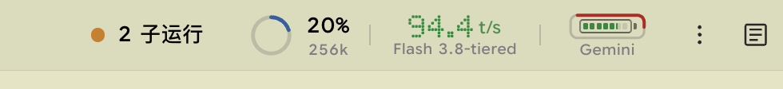
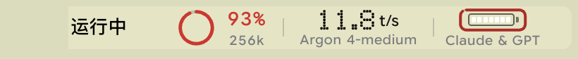
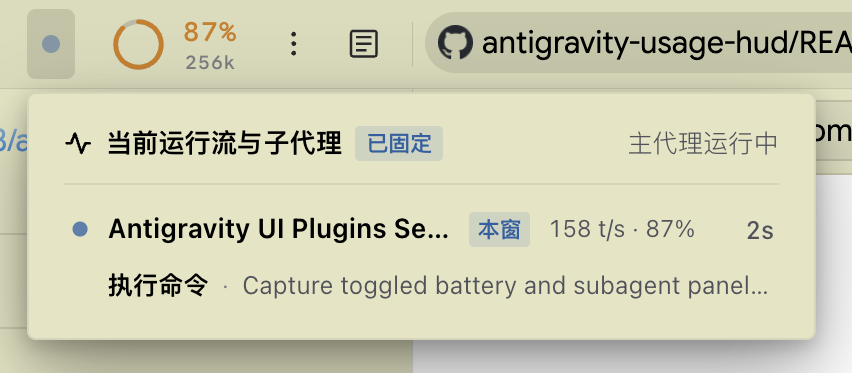

# Antigravity Usage HUD

English | [简体中文](README.zh-CN.md)

**A clean topbar status strip for Google Antigravity — see subagents, context window, generation speed, and dual-pool battery quota at a glance without opening any panel.**



---

## 1. Dual-Pool Battery Toggle (`Gemini` ↔ `Claude & GPT`)

- The battery on the right shows your **5-hour quota** (7 cells, ~14% each) inside and your **weekly quota** as the retro-red outer border ring.
- By default, it automatically matches the quota pool of the current conversation's model.
- **Only the battery is clickable**: click it once to switch in place between **`Gemini` (deep green)** and **`Claude & GPT` (pure white)** — zero layout shift, no popup panel, and hovering context or speed will not light up.

| Pool | Live Topbar HUD |
| :--- | :--- |
| **`Gemini` Pool**<br>*(Deep Green 7-cell battery + red weekly ring)* |  |
| **`Claude & GPT` Pool**<br>*(Click battery to toggle in place — Pure White 7-cell battery + red weekly ring)* |  |

---

## 2. Speed Color Tiers & Context Ring States

Everything updates in place for the **active window only**:

- **Dot-Matrix Speed (`t/s`) + Model Sublabel**:
  - `< 46 t/s`: neutral dark/white (shown in the `11.8 t/s · Argon 4-medium` capture above)
  - `46 – 99 t/s`: **deep green** (`#148838`, shown in the `94.4 t/s` banner at the top)
  - `100 – 179 t/s`: **deep orange** (`#c2410c`, shown in the `122 t/s` capture above)
  - `≥ 180 t/s`: **deep purple** (`#7e22ce`)
- **2× Context Ring + Window Capacity (`256k` / `512k` / `1M`)**:
  - Normal (`< 70%`): blue ring (`20%` / `34%` above)
  - Warning (`70% – 87%`): orange ring (`87%` below)
  - Critical (`≥ 88%`): red ring (`93%` above)
- **New Chat Auto-Reset**: Switching to a New Conversation immediately clears context (`0%`) and speed (`待命`) so previous chats never leak over.

---

## 3. Single-Window Subagent Stream (Left Pill)

The left pill (`0 子代理` / `2 子运行`) tracks only the current window's main agent and subagents. Hover or click it to view the live subagent stream:



---

## Install

Keep the folder name as `usage-monitor` (no `npm install` needed):

**macOS / Linux**
```bash
git clone https://github.com/Malpaca33/antigravity-usage-hud.git ~/.gemini/config/plugins/usage-monitor
```

**Windows (PowerShell)**
```powershell
git clone https://github.com/Malpaca33/antigravity-usage-hud.git "$env:USERPROFILE\.gemini\config\plugins\usage-monitor"
```

Enable `usage-monitor` under **Customizations -> Installed** in Antigravity.  
*(The original 4-tab sidecar panel remains accessible via `⋮ -> Extensions -> 用量监控`.)*

---

## Credits & License

Redesigned from [yuhuan-dev/antigravity-usage-monitor](https://github.com/yuhuan-dev/antigravity-usage-monitor) under [GPL-3.0](LICENSE).
