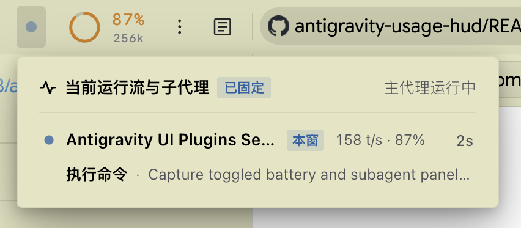
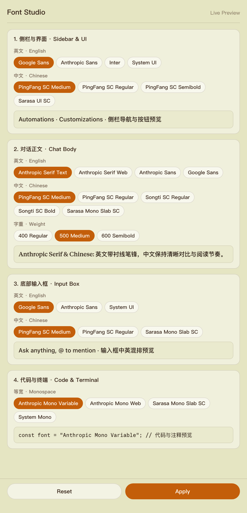

# Antigravity UI Suite

[English](README.md) | 简体中文

**Google Antigravity 界面增强套件，包含两大独立组件：**

1. **Usage HUD**：顶栏极简状态条，直接看子代理、上下文、推理速度和双池电池余量。
2. **Font Studio**：侧边栏字体工坊插件，按界面区域分别配置中英文字体、字重并实时热生效。

---

## 快速上手 · Quick Start

### 1. 环境要求
- macOS（Apple Silicon / Intel）
- Google Antigravity 2.0+
- Node.js 18+

### 2. 一键安装与启用
```bash
git clone https://github.com/Malpaca33/antigravity-ui-suite.git /tmp/ag-ui-suite
mkdir -p ~/.gemini/config/plugins/usage-monitor ~/.gemini/config/plugins/font-studio
cp -r /tmp/ag-ui-suite/plugin.json /tmp/ag-ui-suite/pricing-catalog.json /tmp/ag-ui-suite/assets /tmp/ag-ui-suite/sidecars ~/.gemini/config/plugins/usage-monitor/
cp -r /tmp/ag-ui-suite/font-studio/* ~/.gemini/config/plugins/font-studio/
```

在 `~/.gemini/config/config.json` 的 `plugins` 中启用两项后重启 Antigravity：
```json
{
  "plugins": {
    "usage-monitor": { "enabled": true },
    "font-studio": { "enabled": true }
  }
}
```

### 3. 卸载与回退
- 在 `Font Studio` 面板底部点击 **Reset** 即可立即恢复原生字体。
- 在 `~/.gemini/config/config.json` 中将对应插件设为 `"enabled": false` 并重启 Antigravity 即可停用。

### 4. 致谢与协议 · Acknowledgements & License
- 本仓库基于上游开源项目 [yuhuan-dev/antigravity-usage-monitor](https://github.com/yuhuan-dev/antigravity-usage-monitor) 扩展而来，感谢原作者的顶栏状态条架构与指标实现。
- 遵循 [MIT / 原仓库 LICENSE](LICENSE) 开源协议；第三方受限字体（如 Anthropic 系列）**不随仓库分发**，请按各自授权自行准备。

---

## 组件一：Antigravity Usage HUD（顶栏状态条）


---

## 1. 双额度池电池原地切换（`Gemini` ↔ `Claude & GPT`）

- 最右侧是一颗 **7 格小电池**：里面一格约 14% 对应 **5 小时窗口剩余额度**，外圈复古红框对应 **周限额余量**。
- 默认当前对话用什么模型，就自动显示对应额度池的电池。
- **整个状态条只有电池可以点**：点一下电池，就在 **`Gemini`（深正绿）** 和 **`Claude & GPT`（纯白）** 两个额度池之间原地切换，位置分毫不差、不弹面板；左边上下文和速度移上去不点亮、不可点。

| 当前显示的额度池 | 顶栏实机效果 |
| :--- | :--- |
| **`Gemini` 额度池**<br>*(深正绿 7 格电池 + 外圈复古红周限额)* |  |
| **`Claude & GPT` 额度池**<br>*(点击电池原地切换：纯白 7 格电池 + 外圈复古红周限额)* |  |

---

## 2. 速度四档变色 & 上下文圆环状态

所有数字只反映**当前窗口对话**，随状态实时变化：

- **点阵速度 (`t/s`) + 模型小字**：
  - `< 46 t/s`：常规白/深灰（见上方 `11.8 t/s · Argon 4-medium` 实机图）
  - `46 – 99 t/s`：**深正绿**（`#148838`，见顶部 `94.4 t/s` 实机图）
  - `100 – 179 t/s`：**深橙色**（`#c2410c`，见上方 `122 t/s` 实机图）
  - `≥ 180 t/s`：**深紫色**（`#7e22ce`）
- **2× 上下文圆环 + 总窗口容量 (`256k` / `512k` / `1M`)**：
  - 正常（`< 70%`）：蓝色圆环（如上方 `20%`、`34%`）
  - 偏高（`70% – 87%`）：橙色告警圆环（如下方 `87%`）
  - 紧迫（`≥ 88%`）：红色高危圆环（如上方 `93%`）
- **新开对话自动归零**：切到 New Conversation 或还没发消息的空对话时，上下文和速度立刻归零（`0%` / `待命`），绝不残留上一条对话的数据。

---

## 3. 左侧子代理实时流面板

最左边状态点（`0 子代理` / `2 子运行`）只统计当前窗口的主代理和子代理，鼠标移上去或点一下可展开实时进度：



---

## 安装

目录名保持为 `usage-monitor`，无需装依赖：

**macOS / Linux**
```bash
git clone https://github.com/Malpaca33/antigravity-usage-hud.git ~/.gemini/config/plugins/usage-monitor
```

**Windows (PowerShell)**
```powershell
git clone https://github.com/Malpaca33/antigravity-usage-hud.git "$env:USERPROFILE\.gemini\config\plugins\usage-monitor"
```

装好后在 Antigravity 左侧 **Customizations -> Installed** 里开启 `usage-monitor` 即可自动显示在顶栏（不改客户端安装包）。  
*需要看历史账单或详细趋势时，仍可从右上角 `⋮ -> Extensions -> 用量监控` 打开原版侧栏面板。*

---

## 致谢与协议

基于 [yuhuan-dev/antigravity-usage-monitor](https://github.com/yuhuan-dev/antigravity-usage-monitor) 改写，沿用 [GPL-3.0](LICENSE) 开源协议。


---

## 组件二：Font Studio（分区字体工坊插件）

位于 [`font-studio/`](font-studio/) 目录，作为独立的 Antigravity 侧边栏插件运行。



### 核心功能

- **四区域独立选配**：
  - 侧栏与界面（Sidebar & UI）
  - 对话正文（Chat Body）
  - 底部输入框（Input Box）
  - 代码与终端（Code & Terminal）
- **中英文分离控制**：
  - 通过 `unicode-range` 将英文与中文分流，例如英文用 `Anthropic Serif Text` 或 `Google Sans`，中文搭配 `PingFang SC Medium`、`Songti SC` 或 `Sarasa Mono Slab SC`。
- **胶囊式即时预览**：
  - 全部选项采用页面内圆角胶囊按钮点选，无原生下拉框失焦弹回问题。
  - 切换任意胶囊后，卡片下方实时渲染对应字体与字重效果。
- **一键热应用与恢复**：
  - 点击 **Apply** 自动生成 `theme.css` 并通过 CDP 热注入当前 Antigravity 窗口。
  - 点击 **Reset** 立即解除覆盖并恢复原生默认字体。
