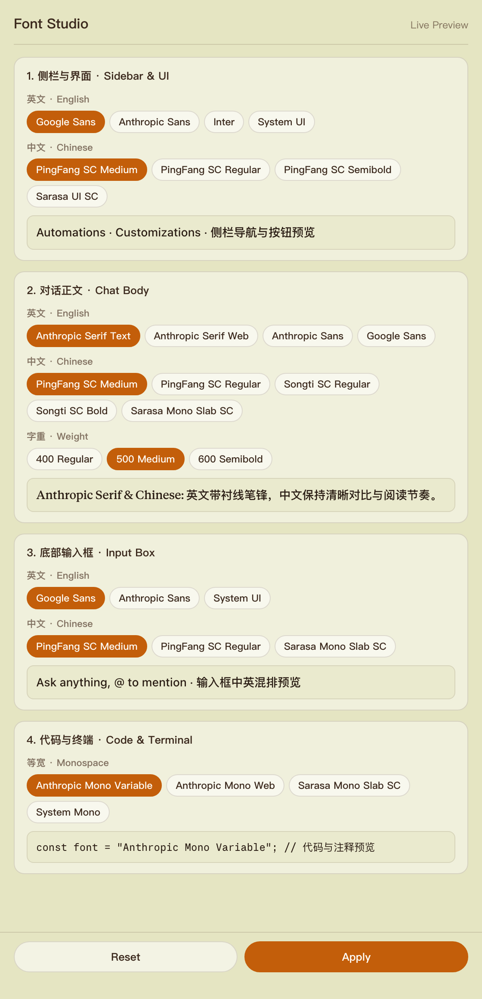

# Font Studio

Antigravity sidecar UI plugin for per-region English & Chinese typography preview and live hot-swapping.

## Features

- **Four Independent Regions**:
  - Sidebar & UI
  - Chat Body
  - Input Box
  - Code & Terminal
- **English / Chinese Split**:
  - Pairs Latin fonts (`Google Sans`, `Anthropic Sans`, `Anthropic Serif Text`, `Inter`) with Chinese fonts (`PingFang SC Medium/Regular/Semibold`, `Songti SC`, `Sarasa Mono Slab SC`, `Sarasa UI SC`) via `unicode-range`.
- **Pill-Based Live Preview**:
  - All options use inline pill buttons with instant per-card live preview.
- **One-Click Apply & Reset**:
  - Click **Apply** to write `theme.css` and hot-inject into Antigravity via CDP.
  - Click **Reset** to restore native defaults.

## Install

1. Copy `font-studio/` to `~/.gemini/config/plugins/font-studio/`.
2. Enable `"font-studio": { "enabled": true }` in `~/.gemini/config/config.json`.
